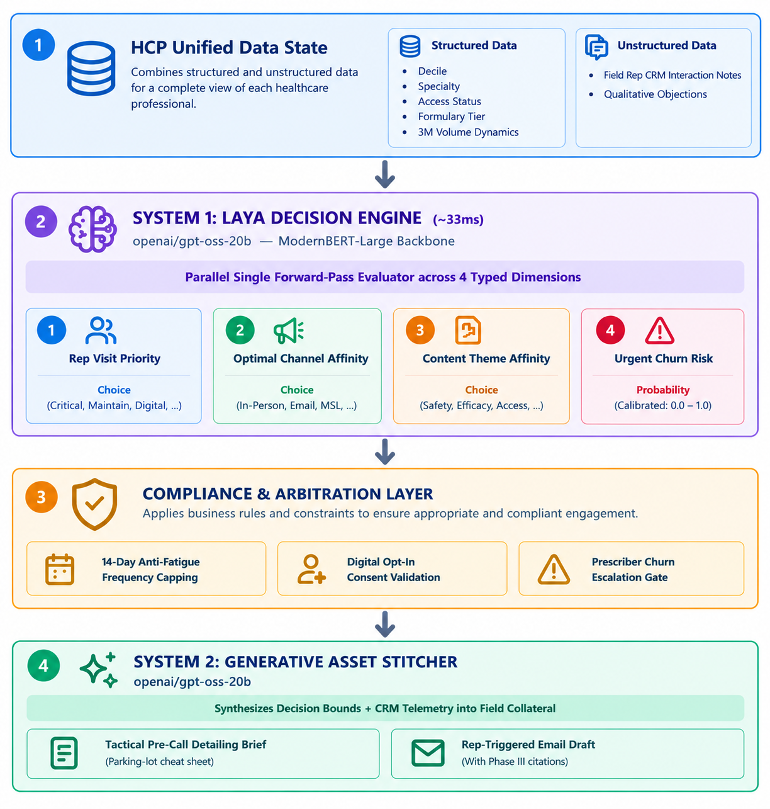
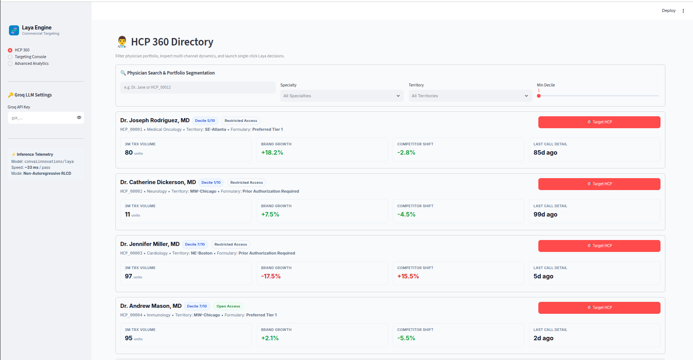
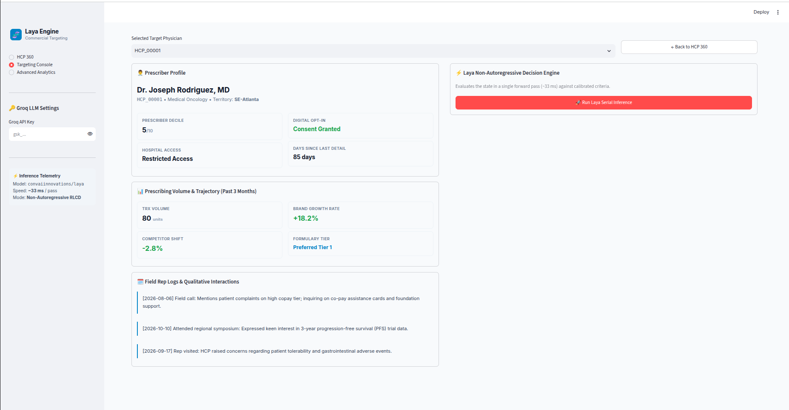
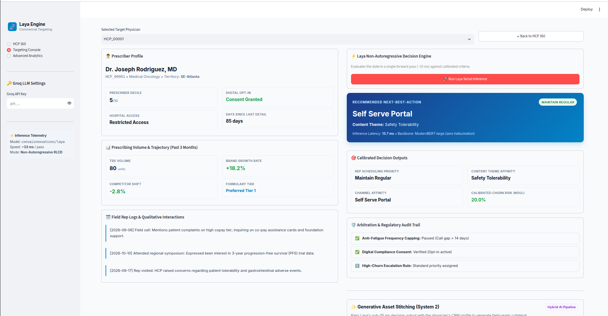
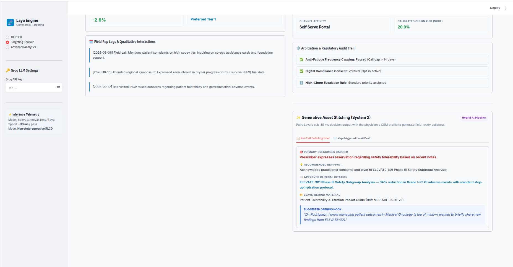
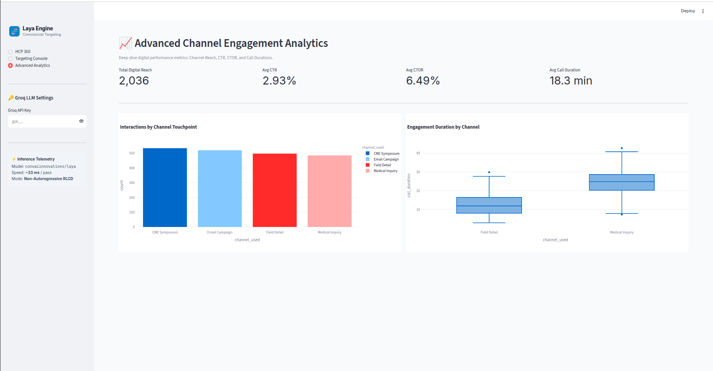

# HCP Targeting Using a System 1 Model - Laya

A hybrid **System 1 / System 2** decision-support prototype for pharmaceutical healthcare professional (HCP) targeting and next-best-action (NBA) recommendations.

- **Live demo:** https://hcp-targeting-nba.streamlit.app/
- **Medium article:** https://medium.com/@sharathhebbar24/hcp-targeting-using-system-one-model-90fa7e613127
- **Repository:** https://github.com/SharathHebbar/HCP_Targeting

> **Disclaimer:** This is a technical prototype using synthetic HCP data. It is not a validated clinical, prescribing, or commercial decision system. Generated content requires appropriate human, medical, legal, regulatory, and company review before real-world use.

## Table of contents

- [Overview](#overview)
- [Architecture](#architecture)
- [System 1: Laya decision engine](#system-1-laya-decision-engine)
- [System 2: Generative asset stitching](#system-2-generative-asset-stitching)
- [Unified HCP state](#unified-hcp-state)
- [Business guardrails](#business-guardrails)
- [Application features](#application-features)
- [Technology stack](#technology-stack)
- [Getting started](#getting-started)
- [Project structure](#project-structure)
- [Performance and limitations](#performance-and-limitations)
- [References](#references)

## Overview

Pharmaceutical commercial teams need to decide which healthcare professionals to engage, which channel to use, what topic to prioritize, and how urgently to act. The relevant information often spans structured prescribing metrics and unstructured field-representative CRM notes.

This project explores a hybrid architecture that separates decision-making from language generation:

1. **System 1** evaluates HCP context and produces structured decision signals.
2. A **compliance and arbitration layer** applies explicit business constraints.
3. **System 2** turns the resulting decision context into field collateral, such as pre-call briefs and email drafts.

The goal is to make the workflow easier to inspect and govern than a single open-ended generative prompt. This architecture does not, by itself, guarantee accuracy, compliance, or deterministic behavior; those properties require testing and governance.

## Architecture



### End-to-end flow

1. Combine HCP profile attributes, recent prescribing dynamics, and qualitative CRM notes.
2. Evaluate the state with the Laya decision engine.
3. Apply business guardrails to the raw outputs.
4. Pass the guardrailed decision context and relevant CRM telemetry to the generative asset stitcher.
5. Present generated collateral for human review.

## System 1: Laya decision engine

The decision core uses [Laya](https://huggingface.co/convaiinnovations/laya), identified in the project as `convaiinnovations/laya`, with a ModernBERT-Large backbone. The article describes it as a non-autoregressive model that evaluates typed decision questions in a single forward pass.

| Decision dimension | Purpose | Example outputs |
|---|---|---|
| Rep visit priority | Suggests field-engagement priority | Critical/immediate, maintain/regular, digital-only, deprioritized |
| Optimal channel | Suggests the next touchpoint | In-person representative, representative-triggered email, MSL/medical inquiry, self-service portal |
| Content focus | Selects a topic relevant to the stated barrier or interest | Clinical efficacy, safety/tolerability, patient support/access, dosing/administration |
| Urgent churn risk | Provides a risk signal for arbitration | Score or probability-like output, subject to validation |

The article reports approximately **33 ms GPU inference latency**. This is a reported project figure, not a general performance guarantee; latency depends on hardware, batch size, runtime configuration, and measurement methodology.

The intent is to use typed decision outputs rather than ask the model to generate an unrestricted narrative. Outputs should be evaluated on representative test cases and appropriately governed data before use in real commercial decisions.

## System 2: Generative asset stitching

The generation layer uses **`openai/gpt-oss-20b` through Groq** to compose field-facing material from decision results and relevant CRM telemetry.

### Tactical pre-call detailing brief

The brief is intended to help a field representative prepare for an interaction. It may include:

- Primary barrier or objection
- Recommended discussion pivot
- Relevant approved clinical evidence or citation
- Suggested opening hook

### Representative-triggered email draft

The model can draft a follow-up email based on the engagement context and content theme. Clinical claims and citations must be checked against approved source material. Generated text is a draft and does **not** independently establish medical accuracy or MLR compliance.

## Unified HCP state

The data pipeline brings profile information, prescribing dynamics, and recent CRM notes into one state representation.

Illustrative synthetic example:

```json
{
  "profile": {
    "specialty": "Medical Oncology",
    "decile": 9,
    "access_level": "Restricted Access",
    "is_kol": true
  },
  "rx_dynamics": {
    "trx_volume_3m": 142,
    "brand_growth_pct": -12.5,
    "competitor_growth_pct": 18.0,
    "formulary_tier": "Preferred Tier 2"
  },
  "recent_crm_notes": [
    "Rep visited 45 days ago: HCP raised concerns about patient tolerability.",
    "Attended a regional symposium and expressed interest in progression-free survival data."
  ]
}
```

This is an illustrative example, not a real HCP record. Combining quantitative and qualitative signals provides more context than relying on a single prescribing metric.

## Business guardrails

Raw model outputs pass through an arbitration layer before being used downstream. The article describes these example controls:

- **14-day contact-frequency cap:** helps avoid excessive field contact.
- **Digital opt-in validation:** checks consent before using a digital channel such as email.
- **Churn-risk escalation:** can increase priority when a configured threshold is crossed.

These prototype rules are not a complete compliance framework. Production use would require review of privacy and consent requirements, contact policies, approved content, audit logging, and human oversight.

## Application features

### HCP 360 directory and filtering

Brings together HCP profile information, prescriber decile, territory, three-month prescription volume, brand growth, and access status. Interactive filtering and a direct action allow users to send an HCP into the targeting workflow.

### Targeting console

Runs the decision pipeline for a selected HCP and displays recommendations for channel, content theme, priority, and churn risk, alongside arbitration information.

### Generative asset stitching

Turns decision context into a pre-call brief or an email draft for review.

### Omnichannel analytics

The article describes engagement telemetry such as digital reach, click-through rate (CTR), click-to-open rate (CTOR), and call-duration distributions where the relevant fields are present.

## Technology stack

| Component | Role |
|---|---|
| Python | Application and data processing |
| Streamlit | Interactive web application |
| Pandas | Tabular data preparation and filtering |
| SQLite | Local persistence for HCP, prescribing, and interaction data |
| Pydantic | Structured data validation |
| Laya | Typed decision inference |
| Groq + `openai/gpt-oss-20b` | Generative collateral drafting |
| Plotly | Visualizations where used |

Check the repository dependency files for exact versions and runtime configuration.

## Getting started

### Prerequisites

- Python version compatible with `pyproject.toml`
- [`uv`](https://docs.astral.sh/uv/) for dependency management
- Credentials for external inference services if required by your local configuration

### 1. Clone the repository

```bash
git clone https://github.com/SharathHebbar/HCP_Targeting.git
cd HCP_Targeting
```

### 2. Install `uv`

Follow the [official installation guide](https://docs.astral.sh/uv/getting-started/installation/).

### 3. Create and activate a virtual environment

```bash
uv venv
```

macOS/Linux:

```bash
source .venv/bin/activate
```

Windows PowerShell:

```powershell
.venv\Scripts\Activate.ps1
```

### 4. Install dependencies

```bash
uv sync
```

### 5. Generate synthetic HCP data

```bash
python synthetic_data_generation.py
```

Review the script and generated files first if you have existing local data to preserve.

### 6. Run the application

```bash
streamlit run app.py
```

Streamlit will print a local URL, usually `http://localhost:8501`.

> **Configuration note:** External model access may require credentials or environment variables. Check the source code for exact variable names. Never commit API keys, secrets, or real HCP data to version control.

## Project structure

```text
HCP_Targeting/
├── assets/                       # Application assets and screenshots
├── app.py                        # Streamlit application
├── asset_stitcher.py              # Generative asset workflow
├── laya_engine.py                 # Decision-engine integration
├── load_and_prep_laya.py          # Data preparation for Laya
├── main.py                        # Additional application entry point
├── synthetic_data_generation.py   # Synthetic HCP data generator
├── pyproject.toml                 # Project/dependency configuration
├── uv.lock                        # Locked dependency versions
└── README.md
```

The repository may contain additional supporting files and local artifacts.

## Performance and limitations

The hybrid design aims to reserve generative inference for content composition while using structured outputs for core decisioning. Potential benefits include more constrained outputs, clearer separation of recommendations from generated text, explicit application-level guardrails, and the ability to test components separately.

Performance and cost advantages should be established with repeatable benchmarks that record hardware, model/runtime versions, warm-up behavior, batch size, latency percentiles, token usage, and failure rates.

Other important limitations:

- Synthetic data does not establish real-world targeting effectiveness.
- Risk estimates require validation and calibration before being interpreted as probabilities.
- Generated citations or clinical statements can be incorrect; verify them against authoritative, approved sources.
- Consent and contact-frequency controls do not replace comprehensive regulatory review.
- Production use requires human oversight, monitoring, access controls, auditability, and data governance.
- Do not send confidential, identifiable, or sensitive HCP information to external services unless the use is approved and the service configuration meets organizational requirements.

## References

- **Live demo:** https://hcp-targeting-nba.streamlit.app/
- **GitHub repository:** https://github.com/SharathHebbar/HCP_Targeting
- **Medium article:** https://medium.com/@sharathhebbar24/hcp-targeting-using-system-one-model-90fa7e613127
- **Laya model:** https://huggingface.co/convaiinnovations/laya
- **Groq model playground:** https://console.groq.com/playground?model=openai/gpt-oss-20b
- **uv documentation:** https://docs.astral.sh/uv/

---

Built by **Sharath S Hebbar**. Issues, contributions, and suggestions are welcome.


## App Screenshots

### HCP 360 Page



### Targeting Console





### Advance Analytics

